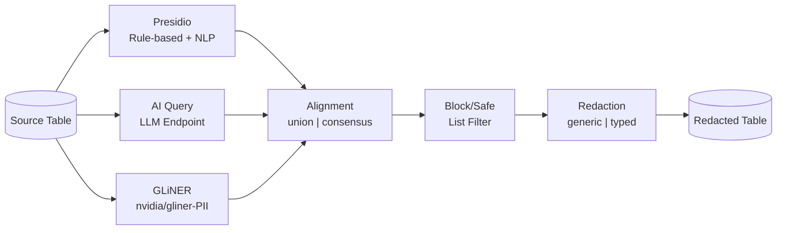
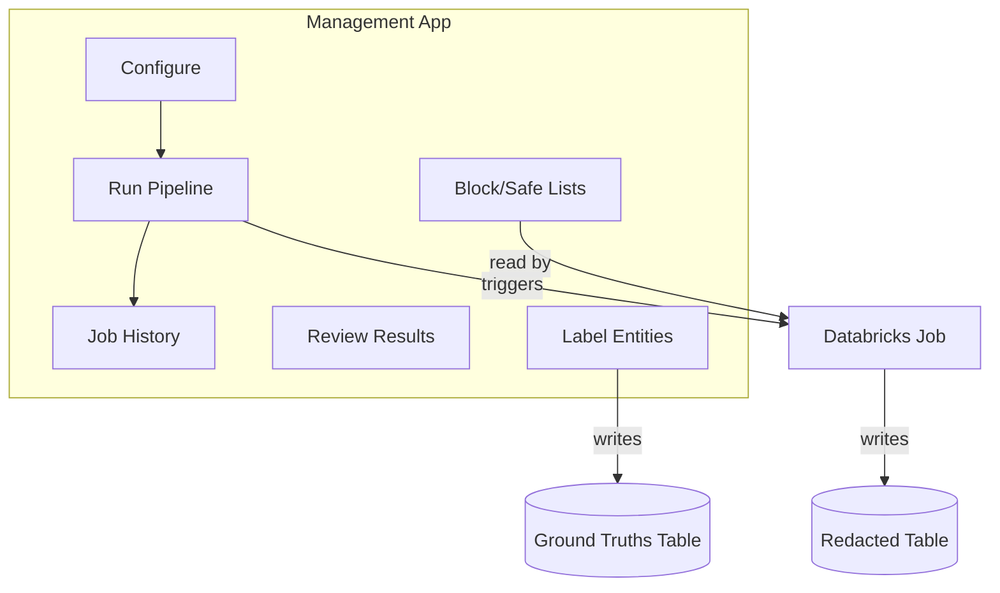
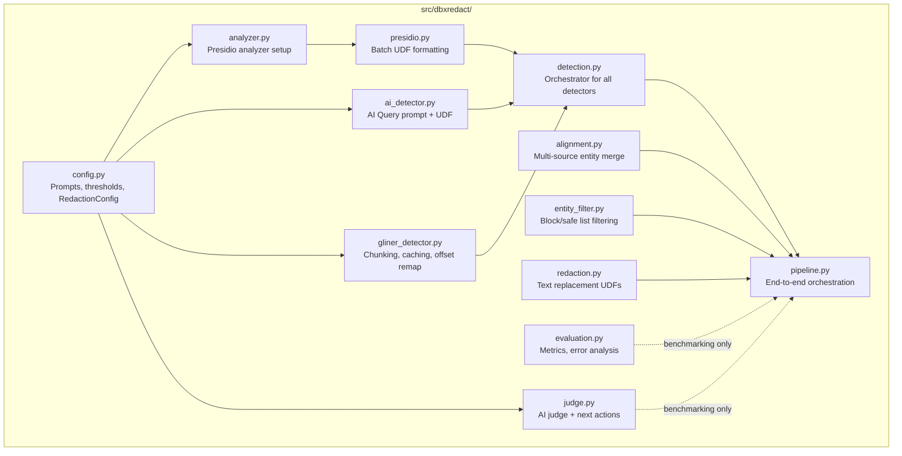
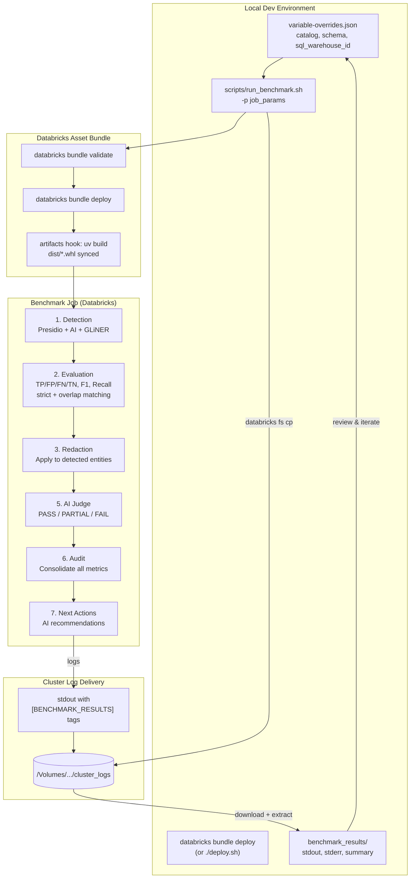

# dbxredact

PII/PHI detection and redaction for Databricks, with a management web app.

> **Disclaimer**: This is a Databricks Solution Accelerator -- a starting point for your project. Evaluate, test, and customize for your use case. Detection accuracy depends on your data and configuration.

## What It Does

dbxredact detects and redacts Protected Health Information (PHI) and Personally Identifiable Information (PII) in text data stored in Unity Catalog. It ships as:

1. **A Python library** (`src/dbxredact/`) with Spark UDFs for detection, alignment, redaction, and evaluation
2. **Databricks notebooks** for running redaction and benchmarking pipelines
3. **A web management app** (FastAPI + React, deployed as a Databricks App) for configuration, pipeline execution, review, and labeling

### Key Capabilities

- **Three detection methods**: Presidio (rule-based NLP), AI Query (LLM endpoints), GLiNER (`nvidia/gliner-PII` transformer NER)
- **Multi-language support**: AI Query and rule-based approaches support Spanish language
- **Entity alignment**: Union (recall-focused) or consensus (precision-focused) across detectors
- **Typed or generic redaction**: `[PERSON]` / `[EMAIL]` or `[REDACTED]`
- **Block / safe lists**: Deny lists (always flag) and allow lists (suppress false positives), stored in UC tables, applied uniformly across all detectors
- **Benchmarking**: Automated evaluation (precision, recall, F1), AI judge grading, and improvement recommendations
- **Streaming**: Incremental processing via Structured Streaming with checkpoint-based deduplication
- **GPU acceleration**: GPU cluster profiles for GLiNER inference
- **Cost estimation**: Pre-run token and compute cost estimates in the management app
- **Safety guards**: Governance floors on thresholds, destructive-write confirmation, PII-output confirmation
- **Audit logging**: Per-document entity-type counts written to an audit table (no raw PII stored)

## Prerequisites

- [Databricks CLI](https://docs.databricks.com/dev-tools/cli/install.html) >= 0.283.0
- [uv](https://docs.astral.sh/uv/getting-started/installation/) >= 0.4 (the bundle builds the wheel with `uv build`)
- Python >= 3.10
- A Databricks workspace with Unity Catalog enabled
- A SQL Warehouse (the management app uses it; you'll supply its ID as the `sql_warehouse_id` bundle variable)

> The React frontend is pre-built and committed under `apps/dbxredact-app/dist/`, so Node.js/npm is **not** required to deploy. You only need it if you're modifying the frontend (`cd apps/dbxredact-app && npm ci && npm run build`).

## Quickstart

### 1. Clone the repository

```bash
git clone https://github.com/databricks-industry-solutions/dbxredact.git
cd dbxredact
```

### 2. Install prerequisites

Make sure you have the tools listed in [Prerequisites](#prerequisites) installed: Databricks CLI (>= 0.283.0), uv (>= 0.4), Node.js/npm (>= 18), and Python (>= 3.10).

Authenticate the Databricks CLI to your workspace:

```bash
databricks auth login --host https://your-workspace.cloud.databricks.com
```

### 3. Create Unity Catalog volumes

Run these SQL statements in your workspace (e.g., via a SQL editor or notebook). Replace `your_catalog` and `your_schema` with your actual catalog and schema names:

```sql
CREATE SCHEMA IF NOT EXISTS your_catalog.your_schema;
CREATE VOLUME IF NOT EXISTS your_catalog.your_schema.cluster_logs;
CREATE VOLUME IF NOT EXISTS your_catalog.your_schema.checkpoints;
```

`cluster_logs` is used by the benchmark job. `checkpoints` is used by the streaming pipeline. (The Python wheel is deployed by the bundle itself -- no `wheels` volume is required.)

> **Note:** These volumes only need to exist in the deployment schema. The redaction pipeline itself can read from and write to any fully qualified table in any schema.

### 4. Deploy

`databricks.yml` is a committed static bundle, so deployment is a plain `databricks bundle deploy`. Per-workspace values (catalog, schema, warehouse ID) come from **bundle variables**; the wheel is built automatically by the bundle's `artifacts` hook (`uv build`).

Supply the variables via a `variable-overrides.json` file that DAB auto-loads for the target (this is the only path it auto-loads -- a repo-root copy is ignored):

```bash
mkdir -p .databricks/bundle/dev
cp variable-overrides.example.json .databricks/bundle/dev/variable-overrides.json
# edit .databricks/bundle/dev/variable-overrides.json with your catalog / schema / sql_warehouse_id
```

Then deploy, start the app, and grant the app its Unity Catalog permissions:

```bash
databricks bundle deploy -t dev                 # builds the wheel + deploys jobs and the app
databricks bundle run dbxredact_app -t dev      # creates + starts the app (and its service principal)
./grant_app_permissions.sh -t dev               # grants the app SPN UC access (see step 5)
```

The workspace host comes from your CLI profile (`databricks auth login` / `-p <profile>`) or the `DATABRICKS_HOST` env var. You can also pass variables without the file via `--var "catalog=...,schema=...,sql_warehouse_id=..."` or `BUNDLE_VAR_*` env vars.

**Deploy from the workspace UI (no local machine):** clone this repo into a [Databricks Git Folder](https://docs.databricks.com/en/repos/index.html), create `.databricks/bundle/dev/variable-overrides.json` in the workspace, open `databricks.yml` and click the **Deploy** (rocket) button, then deploy + start the app from **Workspace > Apps**. Finally run the grants (step 5).

**Jobs-only mode (no app):** comment out the `- resources/app.yml` line in the `include:` block of `databricks.yml` before deploying, and skip the `bundle run dbxredact_app` and grants steps.

#### Optional: guided wrapper (`deploy.sh`)

If you prefer an interactive, `.env`-driven flow, `deploy.sh` wraps all of the above. It reads a `dev.env` / `prod.env` (copy from `example.env`), writes the `variable-overrides.json` for you, then runs validate → deploy → start app → grants, prompting before each step. It also supports `DEPLOY_APP=false` for jobs-only deploys. This script is **optional** -- the plain `databricks bundle deploy` flow above is fully sufficient.

```bash
cp example.env dev.env   # fill in DATABRICKS_HOST, CATALOG, SCHEMA, WAREHOUSE_ID
./deploy.sh dev          # add -y to skip the interactive confirmations
```

### 5. Grant the app its Unity Catalog permissions

The Databricks App runs as its own service principal, which needs UC access to read/write tables in your schema. This grant **cannot** be expressed in the bundle (the service principal doesn't exist until the app is created), so it runs as a separate step after the app's first start:

```bash
./grant_app_permissions.sh -t dev
```

The script resolves the app service principal and runs the five required grants. If you'd rather do it manually (or you lack the CLI), paste these into a SQL editor as a catalog admin, replacing `<application_id>` with the app SPN's applicationId (**Admin Console > Service Principals > dbxredact-app**) and `<catalog>`/`<schema>` with your values:

```sql
GRANT USE CATALOG ON CATALOG `<catalog>` TO `<application_id>`;
GRANT USE SCHEMA  ON SCHEMA `<catalog>`.`<schema>` TO `<application_id>`;
GRANT CREATE TABLE ON SCHEMA `<catalog>`.`<schema>` TO `<application_id>`;
GRANT SELECT ON SCHEMA `<catalog>`.`<schema>` TO `<application_id>`;
GRANT MODIFY ON SCHEMA `<catalog>`.`<schema>` TO `<application_id>`;
```

### 6. Run a pipeline

**From the app** (recommended): Open the deployed Databricks App, go to "Run Pipeline", select your source table, choose a cluster profile, and click "Launch".

**From CLI**:

```bash
databricks bundle run redaction_pipeline_cpu_small -t dev \
  --notebook-params source_table=catalog.schema.source,text_column=text,output_table=catalog.schema.redacted
```

### Alternative: Git Folder (Not Recommended)

> This approach is for quick evaluation only. You get the **notebooks and Python library**, but **not** the management app, pre-configured jobs, or cluster profiles. For the full experience, use the DAB deployment above.

The management app cannot run via Git Folder because it requires the Databricks App runtime (which builds the React frontend and binds job resources at deploy time).

To use this approach, clone the repo into a [Databricks Git Folder](https://docs.databricks.com/en/repos/index.html), then install the library in your notebook:

```python
# Install directly from GitHub (no local build needed):
%pip install git+https://github.com/databricks-industry-solutions/dbxredact.git

# Or, if you have a pre-built wheel in a UC volume:
%pip install /Volumes/your_catalog/your_schema/your_volume/dbxredact-0.3.1-py3-none-any.whl
```

Then open `notebooks/4_redaction_pipeline.py`, configure the widgets at the top of the notebook, and run all cells. You will need to attach the notebook to an ML-runtime cluster yourself.

## Detection Methods

| Method | Model | When to Use |
|--------|-------|-------------|
| **Presidio** | spaCy `en_core_web_trf` (auto-falls back to `_lg`/`_sm`) | Fast, deterministic, no API calls |
| **AI Query** | Databricks LLM endpoints (default: `databricks-gpt-oss-120b`) | Context-aware detection of complex patterns |
| **GLiNER** | `nvidia/gliner-PII` (55+ entity types) | Transformer NER, GPU-accelerated, no API calls |

Detection methods can be used individually or in ensemble. Ensemble results are merged via configurable alignment (union or consensus).

### Detection Profiles

| Profile | Detectors | GLiNER Chunk | Presidio | Best For |
|---------|-----------|-------------|----------|----------|
| **Fast** (default) | AI Query (low) + GLiNER + Presidio (pattern-only) | 256 words | Pattern-only (no spaCy) | Routine redaction, large-scale batch |
| **Deep** | All three | 256 words | spaCy trf | Compliance-critical, maximum recall |
| **Custom** | Manual | Manual | Manual | Experimenting with specific configs |

The **fast** profile achieves F1~0.89 (overlap) across benchmark datasets by combining AI Query with GLiNER and Presidio in pattern-only mode (deterministic regex for SSN, phone, MRN, dates -- no spaCy required).

### Presidio Pattern-Only Mode

When Presidio is enabled, it normally loads spaCy NER models (400+ MB). If you want deterministic pattern-based detection as a lightweight backup (SSN, phone, MRN, dates, reference IDs) without the spaCy dependency, pass `presidio_pattern_only=True`:

```python
result_df = run_detection_pipeline(
    spark=spark, source_df=df, doc_id_column="doc_id", text_column="text",
    use_presidio=True, use_ai_query=True, use_gliner=True,
    presidio_pattern_only=True,  # regex-only, no spaCy
)
```

Pattern-only mode includes 25 high-precision regex recognizers covering HIPAA Safe Harbor identifiers: SSN (with and without dashes), phone, email, credit card, IP, MRN, reference IDs, age/gender, DD/MM dates, DEA numbers, NPI, labeled DOB, fax, health plan IDs, account numbers, VIN, EIN, license numbers, MBI (Medicare Beneficiary ID), passport, labeled ZIP codes, routing numbers, and ITIN. NER-based recognizers (PERSON, LOCATION) are skipped.

### Benchmark Interpretation

Ground-truth annotations may not be perfect -- some edge cases (3-letter hospital abbreviations, bare number sequences, standalone day names) represent a ceiling that no general model will fully reach. When evaluating benchmark results:

- Focus on **aligned recall** (the aligned output is what drives redaction) and **precision** (false positives erode user trust).
- Use **block lists** to force-flag known entities that detectors miss, and **safe lists** to suppress recurring false positives.
- Re-run benchmarks after config changes to measure the actual impact.

## Built-in alternative: ai_mask

Databricks also has a built-in SQL function, `ai_mask`, that masks sensitive values in text inside a query, with no library, cluster, or model endpoint to deploy. It runs on Databricks SQL warehouses (not SQL Classic) and on Databricks Runtime clusters, in regions that support AI Functions. For requirements, syntax, and the full classifier list, see the `ai_mask` reference for [AWS](https://docs.databricks.com/aws/en/sql/language-manual/functions/ai_mask), [Azure](https://learn.microsoft.com/en-us/azure/databricks/sql/language-manual/functions/ai_mask), and [GCP](https://docs.databricks.com/gcp/en/sql/language-manual/functions/ai_mask).

**Version 1.0**, the default, available on AWS, Azure and GCP, takes plain-language labels and replaces each match with `[MASKED]`:

```sql
SELECT
  note_id,
  ai_mask(note_text, array('person', 'email', 'phone', 'date of birth')) AS note_masked
FROM catalog.schema.notes;
```

**Version 2.0** (Beta, on AWS US regions; the reference lists all supported regions) uses a Databricks-built detection model with a fixed set of classifiers, such as `NAME`, `EMAIL_ADDRESS`, `PHONE_NUMBER`, and `US_SSN`, and replaces each value with a typed placeholder such as `[NAME]`. Opt in per call with `options => map('version', '2.0')`, and omit the classifier list to use the default set. A call without that option runs version 1.0, which reads classifier names as plain labels and returns `[MASKED]`. The result is a `VARIANT`; read `response` for the masked text and `error_message` for rows that could not be processed:

```sql
SELECT
  note_id,
  masked:response::string AS note_masked,
  masked:error_message::string AS mask_error
FROM (
  SELECT
    note_id,
    ai_mask(
      note_text,
      array('NAME', 'EMAIL_ADDRESS', 'PHONE_NUMBER', 'US_SSN'),
      options => map('version', '2.0')
    ) AS masked
  FROM catalog.schema.notes
);
```

Version 2.0 isn't available on workspaces with the compliance security profile; use version 1.0 there. Beta behavior can change before general availability.

**When to use dbxredact instead.** `ai_mask` returns masked text, not entity spans, so it does not feed this accelerator's alignment, block / safe lists, evaluation, or review app. Use dbxredact when you need entity-level output, an ensemble of detectors, block / safe lists, benchmarking against your own labeled data, your own model or endpoint (for example a fine-tuned GLiNER), or typed placeholders on Azure or GCP. Both work on text only; extract text from images or scanned documents first. As with any redaction approach, validate the output on your own data (see [Compliance and Responsibility](#compliance-and-responsibility)).

## Cluster Profiles

Six pre-configured job variants ship with the bundle:

| Profile | Workers | Instance (default) | Use Case |
|---------|---------|----------|----------|
| CPU Small | 2 | i3.xlarge | Development, small datasets |
| CPU Medium | 5 | i3.xlarge | Medium workloads |
| CPU Large | 10 | i3.xlarge | Production scale |
| GPU Small | 2 | g5.xlarge | GLiNER, small datasets |
| GPU Medium | 5 | g5.xlarge | GLiNER, medium datasets |
| GPU Large | 10 | g5.xlarge | GLiNER at scale |

GPU profiles use Databricks Runtime `17.3.x-gpu-ml-scala2.13`.

### Cloud-Specific Node Types

The default instance types are AWS-specific. Azure workspaces must override `cpu_node_type` and `gpu_node_type` in `variables.yml` or their target config:

| Type | AWS (default) | Azure equivalent |
|------|---------------|------------------|
| CPU | i3.xlarge | Standard_DS3_v2 |
| GPU | g5.xlarge | Standard_NC4as_T4_v3 |

If you see `Node type X is not supported` during deployment, set the correct node type for your cloud in `variables.yml`:
```yaml
cpu_node_type:
  default: "Standard_DS3_v2"
gpu_node_type:
  default: "Standard_NC4as_T4_v3"
```

## Management App

dbxredact includes a web application deployed as a [Databricks App](https://docs.databricks.com/en/dev-tools/databricks-apps/index.html). The app provides:

- **Configuration**: Create and manage detection configurations (enable/disable detectors, set thresholds, choose endpoints)
- **Block / Safe Lists**: Add terms to block lists (always flag) or safe lists (suppress false positives) via the UI
- **Run Pipeline**: Select a source table, choose a cluster profile (CPU/GPU, Small/Medium/Large), view cost estimates, and trigger redaction jobs
- **Job History**: Monitor pipeline runs with status tracking, cost estimates, and links to Databricks job runs
- **Review**: Side-by-side comparison of original and redacted text
- **Labeling**: Annotate entities by highlighting text to build ground-truth datasets for evaluation
- **Admin**: PII retention monitoring, annotation purge (`POST /api/admin/purge-annotations`), and audit log viewer

The app is defined in `apps/dbxredact-app/` and deployed via the Databricks Asset Bundle (`resources/app.yml`).

### App Environment Variables

| Variable | Default | Description |
|----------|---------|-------------|
| `DATABRICKS_WAREHOUSE_ID` | (required) | SQL warehouse for app queries (note: the *job* variable is `WAREHOUSE_ID`; the *app* uses `DATABRICKS_WAREHOUSE_ID`) |
| `CATALOG` / `SCHEMA` | (required) | Unity Catalog location for app tables |
| `ALLOWED_ORIGINS` | `*` | Comma-separated CORS origins (set for production) |
| `RETENTION_DAYS` | `90` | Days before PII retention warnings fire for annotation/ground-truth tables |
| `DEBUG` | `false` | When `true`, error responses include exception details |

## Architecture

### Detection Pipeline



### Management App



### Pipeline Module Structure



### Benchmarking & Development Feedback Loop



## Notebooks

| Notebook | Purpose |
|----------|---------|
| `4_redaction_pipeline.py` | Production redaction (full or incremental) |
| `0_load_benchmark_data.py` | Upload benchmark CSVs to Unity Catalog |
| `1_benchmarking_detection.py` | Run all detection methods |
| `2_benchmarking_evaluation.py` | Precision, recall, F1 (strict + overlap matching) |
| `3_benchmarking_redaction.py` | Apply redaction to detection results |
| `5_benchmarking_judge.py` | AI judge grades redacted output |
| `6_benchmarking_audit.py` | Consolidate metrics into audit table |
| `7_benchmarking_next_actions.py` | AI-generated improvement recommendations |
| `9_gliner_fine_tuning.py` | Fine-tune GLiNER on custom labeled data |

> **Synthetic benchmark data** is included in `data/` with ground-truth PII annotations (NAME, DATE, LOCATION, IDNUM, CONTACT):
>
> | File | Domain | Docs | Annotations |
> |------|--------|------|-------------|
> | `synthetic_benchmark_medical.csv` | Clinical (discharge summaries, lab reports, etc.) | 10 | ~180 |
> | `synthetic_benchmark_finance.csv` | Financial (wire transfers, loans, KYC, tax, etc.) | 10 | ~250 |
> | `synthetic_benchmark.csv` | Combined | 20 | ~430 |
>
> Upload a CSV to a Unity Catalog table and use it as both the source and ground truth for the benchmarking notebooks. To regenerate or customize: `python scripts/generate_synthetic_benchmark.py --domain medical|finance|all`.
>
> **Important:** After regenerating CSVs, you must re-upload the data to your Unity Catalog table for the updated annotations to take effect in benchmarking. Example:
> ```sql
> DROP TABLE IF EXISTS your_catalog.your_schema.synthetic_benchmark_medical;
> -- Then re-create from CSV upload or use the Databricks UI file upload
> ```
>
> For larger-scale evaluation, supply your own labeled dataset and update the widget defaults accordingly.

## API Reference

### Full Pipeline

```python
from dbxredact import RedactionConfig, run_redaction_pipeline

config = RedactionConfig(
    use_presidio=True, use_ai_query=True, use_gliner=False,
    redaction_strategy="typed",
)

result_df = run_redaction_pipeline(
    spark=spark,
    source_table="catalog.schema.medical_notes",
    text_column="note_text",
    output_table="catalog.schema.medical_notes_redacted",
    config=config,
)
```

### Detection Only

```python
from dbxredact import run_detection_pipeline

result_df = run_detection_pipeline(
    spark=spark,
    source_df=source_df,
    doc_id_column="doc_id",
    text_column="text",
    use_presidio=True,
    use_ai_query=True,
    endpoint="databricks-gpt-oss-120b",
)
```

### Simple Text Redaction

```python
from dbxredact import redact_text

text = "Patient John Smith (SSN: 123-45-6789) visited on 2024-01-15."
entities = [
    {"entity": "John Smith", "start": 8, "end": 18, "entity_type": "PERSON"},
    {"entity": "123-45-6789", "start": 25, "end": 36, "entity_type": "US_SSN"},
]
result = redact_text(text, entities, strategy="typed")
# "Patient [PERSON] (SSN: [US_SSN]) visited on 2024-01-15."
```

## Block / Safe Lists

Block and safe lists are applied as post-processing filters after detection and alignment, not as Presidio custom recognizers. This means they work uniformly across all three detection methods. **Block lists** force specific terms to always be flagged as PII. **Safe lists** suppress false positives by removing matches. They are stored as Unity Catalog tables (`redact_block_list`, `redact_safe_list`) and can be managed through the app UI or SQL.

See `src/dbxredact/entity_filter.py` for the `EntityFilter` API and `load_filter_from_table` to load lists from Unity Catalog tables.

## Streaming (Incremental) Mode

The redaction pipeline supports incremental processing via Structured Streaming. Select **incremental** for the "Refresh Approach" widget in `4_redaction_pipeline.py`, or call `run_redaction_pipeline_streaming` directly.

### Key operational notes

- **Deduplication (best effort)**: The streaming pipeline makes a best effort to deduplicate by `doc_id` within each micro-batch before writing via `MERGE INTO`. However, it does **not** guarantee cross-batch deduplication — if the same `doc_id` appears in two different micro-batches, the later batch will overwrite the earlier result rather than skip it. For strict deduplication guarantees, use the batch pipeline, which calls `.distinct()` on the full source before processing.
- **Checkpoint coupling**: The streaming checkpoint is tightly coupled to the Spark query plan. If you change which detectors are enabled, switch alignment mode, or modify detection logic, delete the checkpoint directory before restarting the stream.
- **`mergeSchema` is on**: Switching between `production` and `validation` output strategies will widen the output table automatically.
- **AI failure flagging**: When AI Query returns an error for a row, the output includes `_ai_detection_failed = True` and a warning is logged. These rows still flow through redaction (using other detectors if available) but should be reviewed or retried.
- **LLM non-determinism**: If a micro-batch is retried after a transient failure, AI Query may produce slightly different results for the same document.
- **`max_files_per_trigger`**: Controls how many files each micro-batch ingests (default 10). Set to 0 / None for unlimited. Useful for throttling first-run backfill on large tables.
- **Checkpoint path**: Should be a Unity Catalog Volume path (`/Volumes/catalog/schema/volume_name/...`). Non-Volume paths (DBFS, local) may not persist across cluster restarts; a warning is emitted if detected.

## Safety Guards

The pipeline enforces several safety gates to prevent accidental PII exposure or data loss:

| Guard | Trigger | Required Opt-in |
|-------|---------|-----------------|
| Destructive write | `output_mode="in_place"` | `confirm_destructive=True` |
| PII in output table | `output_strategy="validation"` | `confirm_validation_output=True` |
| Low-recall alignment | `alignment_mode="consensus"` | `allow_consensus_redaction=True` |

Detection thresholds have governance floors to prevent configs that silently disable detection: `score_threshold` must be >= 0.1 and `gliner_threshold` must be >= 0.05. The `RedactionConfig` dataclass and the app's API schema both enforce these bounds.

## Pipeline Details

### Output Columns

The pipeline reads only `doc_id` and the specified `text_column` from the source table. Other source columns are **not** carried to the output.

- **Production mode** (default): Output contains `doc_id`, `{text_column}_redacted`, `_detection_status`, and `_entity_count`.
- **Validation mode**: Output includes all intermediate columns (raw detector results, aligned entities, redacted text) for debugging. Requires `confirm_validation_output=True` since it persists raw PII.

| Column | Description |
|--------|-------------|
| `doc_id` | Document identifier (join key) |
| `{text_column}_redacted` | Redacted text |
| `_detection_status` | `ok`, `no_entities`, or `detection_error` |
| `_entity_count` | Number of entities detected in the document |

To join redacted output back to your original table, use `doc_id` as the key:

```sql
SELECT o.*, r.text_redacted
FROM catalog.schema.original o
JOIN catalog.schema.redacted r ON o.doc_id = r.doc_id
```

### Multiple Column / Table-Level Redaction

`run_table_redaction` handles multiple text columns and structured PII columns in a single pass. It runs NER on each text column independently and applies rule-based masking to structured columns (SSN, phone, email, etc.):

```python
from dbxredact.pipeline import run_table_redaction

result_df = run_table_redaction(
    spark=spark,
    source_table="catalog.schema.patients",
    output_table="catalog.schema.patients_redacted",
    text_columns=["clinical_notes", "discharge_summary"],
    structured_columns={"ssn": "ssn", "phone": "phone", "email": "email"},
    redaction_strategy="typed",
    masking_strategy="mask",  # or "hash" / "encrypt"
)
```

If you only need single-column NER redaction, `run_redaction_pipeline` is simpler:

```python
run_redaction_pipeline(spark, source_table=..., text_column="notes",
                       output_table=..., config=config)
```

### Document Length

No explicit limit. Practical limits depend on the detection method:

- **GLiNER**: Handles long texts internally via word-boundary chunking with automatic offset correction (`_chunk_and_predict`). No user-side chunking needed.
- **AI Query**: Subject to the LLM endpoint's context window / token limit. Documents exceeding the limit will be truncated by the endpoint.
- **Presidio**: Processes text in-memory via spaCy. No hard cap, but very large documents may be slow.

### In-Place Redaction

By default the pipeline writes to a separate output table. To overwrite the text column directly in the source table, use `output_mode="in_place"`. This uses `MERGE INTO` so only processed rows are touched.

```python
run_redaction_pipeline(
    spark=spark,
    source_table="catalog.schema.notes",
    text_column="note_text",
    output_mode="in_place",
    confirm_destructive=True,  # required -- operation is irreversible
    config=config,
)
```

### RedactionConfig

Instead of passing 25+ keyword arguments, use `RedactionConfig` to bundle pipeline settings. When `config` is provided, its fields override any matching kwargs.

```python
from dbxredact import RedactionConfig, run_redaction_pipeline

config = RedactionConfig(
    use_presidio=True,
    use_ai_query=True,
    use_gliner=False,
    presidio_pattern_only=True,
    score_threshold=0.5,
    redaction_strategy="typed",
    output_strategy="production",
)

result_df = run_redaction_pipeline(
    spark=spark,
    source_table="catalog.schema.notes",
    text_column="note_text",
    output_table="catalog.schema.notes_redacted",
    config=config,
)
```

### Audit Logging

Pass `audit_table` to write per-document entity-type counts (no raw PII) for compliance tracking:

```python
run_redaction_pipeline(
    ...,
    audit_table="catalog.schema.redact_audit_log",
)
```

The audit log records `run_id`, `doc_id`, `entity_type`, `entity_count`, `detection_status`, `detectors_used`, and a config snapshot. The management app creates this table automatically on startup.

## Project Structure

```
dbxredact/
  databricks.yml                    # DAB config (static, committed -- deploy with `databricks bundle deploy`)
  variable-overrides.example.json   # Template for .databricks/bundle/<target>/variable-overrides.json
  grant_app_permissions.sh          # Post-deploy UC grants for the app service principal
  deploy.sh                         # Optional guided wrapper (.env-driven) around bundle deploy
  pyproject.toml                    # Dependencies and build config (PEP 621 + hatchling)
  variables.yml                     # Bundle variables (catalog, schema, etc.)
  example.env                       # Template for dev.env / prod.env (used by deploy.sh)
  src/dbxredact/             # Core Python library
    config.py                #   Prompts, thresholds, RedactionConfig dataclass
    analyzer.py              #   Custom Presidio recognizers (HIPAA Safe Harbor)
    detection.py             #   Orchestrator for all detectors
    gliner_detector.py       #   GLiNER batch UDF with worker-level model cache
    presidio.py              #   Presidio batch UDF
    ai_detector.py           #   AI Query prompt construction + UDF
    alignment.py             #   Multi-source entity merge (union/consensus)
    redaction.py             #   Text replacement UDFs (with span merging)
    entity_filter.py         #   Block/safe list filtering
    pipeline.py              #   End-to-end orchestration + safety guards
    evaluation.py            #   Metrics (precision, recall, F1)
    judge.py                 #   AI judge + next actions
    cost.py                  #   Token cost estimation constants
  notebooks/                 # Databricks notebooks
    4_redaction_pipeline.py  #   Production redaction pipeline
    0_load_benchmark_data.py #   Upload benchmark CSVs to UC
    1-7_benchmarking_*.py    #   Benchmarking pipeline steps
    9_gliner_fine_tuning.py  #   GLiNER fine-tuning notebook
  apps/dbxredact-app/        # Management web app
    app.py                   #   FastAPI entry point + SPA serving
    api/                     #   Backend API routes and services
    src/                     #   React frontend source
    package.json             #   Node.js dependencies
  resources/                 # DAB resource definitions
    jobs.yml                 #   Job definitions (CPU/GPU x Small/Medium/Large)
    app.yml                  #   App resource definition
  scripts/                   # Utility scripts
  data/                      # Synthetic benchmark datasets
  tests/                     # Unit tests
```

## Testing

```bash
uv sync

# Unit tests (no external dependencies)
uv run pytest tests/ -x -q --ignore=tests/integration

# Integration tests (uses local PySpark -- no Databricks connection needed)
uv run pytest tests/integration/ -x -q

# App API tests
uv run pytest apps/dbxredact-app/tests/ -x -q
```

Unit tests and integration tests should be run separately (different CI jobs). Integration tests use a local SparkSession and test the full detection/redaction pipeline with mocked detectors.

### Pre-release sanity checks (real end-to-end, on a workspace)

Before a release, run the wave-based integration-test job against a real catalog. Unlike the
local tests above, these notebooks (`notebooks/integration_tests/`) run on real clusters with
real detectors and real Unity Catalog tables, and assert both detection quality (known PII is
actually redacted) and that the safety guards fire. The suite creates and drops its own tables
and a `test_volume` under the chosen `test_schema`.

The job (`resources/tests/integration_tests.job.yml`) is **not deployed by default** -- it is
excluded from the normal bundle so test clusters/jobs never ship with the app. To run it:

```bash
# 1. Uncomment the tests include in databricks.yml:
#      # - resources/tests/integration_tests.job.yml
#    -> - resources/tests/integration_tests.job.yml

# 2. Deploy (builds the wheel + creates the integration_tests job)
databricks bundle deploy -t dev

# 3. Run it, parameterizing the catalog at run time (nothing workspace-specific is committed):
databricks bundle run integration_tests -t dev \
  --params test_catalog=<your_catalog>,test_schema=dbxredact_tests,endpoint=databricks-gpt-oss-120b
```

`test_catalog` defaults to blank, in which case each notebook falls back to the cluster's
current catalog. The waves are ordered cheapest-first: **Wave A** (imports/config) and
**Wave B** (Presidio-only detection, redaction, and structured masking -- `test_15`) cost no
LLM tokens; **Wave C** (AI Query, ensemble, consensus, and ingestion formats -- `test_16`),
**Wave D** (advanced features), and **Wave E** (end-to-end, incl. GPU/GLiNER) consume model
tokens and GPU compute. To skip the expensive waves, run individual tasks from the Jobs UI.

## Compute Types
Use an ML cluster - not currently working on serverless. GLiNER models perform better on GPU, but other models do not.

## Libraries

### Core Dependencies

| Library | Version | License | Description | PyPI |
|---------|---------|---------|-------------|------|
| presidio-analyzer | 2.2.358 | MIT | Microsoft Presidio PII detection engine | [PyPI](https://pypi.org/project/presidio-analyzer/) |
| presidio-anonymizer | 2.2.358 | MIT | Microsoft Presidio anonymization engine | [PyPI](https://pypi.org/project/presidio-anonymizer/) |
| spacy | 3.8.7 | MIT | Industrial-strength NLP library | [PyPI](https://pypi.org/project/spacy/) |
| gliner | >=0.2.0 | Apache 2.0 | Generalist NER using bidirectional transformers | [PyPI](https://pypi.org/project/gliner/) |
| rapidfuzz | >=3.0.0 | MIT | Fast fuzzy string matching | [PyPI](https://pypi.org/project/rapidfuzz/) |
| pydantic | >=2.0.0 | MIT | Data validation using Python type hints | [PyPI](https://pypi.org/project/pydantic/) |
| pyyaml | >=6.0.1 | MIT | YAML parser and emitter | [PyPI](https://pypi.org/project/PyYAML/) |
| databricks-sdk | >=0.30.0 | Apache 2.0 | Databricks SDK for Python | [PyPI](https://pypi.org/project/databricks-sdk/) |

### GLiNER Model

| Model | License | Description | HuggingFace |
|-------|---------|-------------|-------------|
| nvidia/gliner-PII | NVIDIA Open Model License | PII/PHI-focused NER model with 55+ entity types | [HuggingFace](https://huggingface.co/nvidia/gliner-PII) |

This solution accelerator uses the `nvidia/gliner-PII` model in accordance with the [NVIDIA Open Model License](https://developer.download.nvidia.com/licenses/nvidia-open-model-license-agreement-june-2024.pdf). The NVIDIA Open Model License permits commercial use and is compatible with the [DB License](LICENSE.md) under which this accelerator is released. However, **use of the model itself is governed by NVIDIA's license terms, not the DB License**. Customers are responsible for reviewing and complying with the NVIDIA Open Model License independently before deploying in production.

### spaCy Models (for Presidio)

The default is `en_core_web_trf` (RoBERTa transformer, NER F1 ~90.2%). The code auto-falls back to `_lg` or `_sm` if `_trf` is not installed. Install the best model available for your cluster:

| Model | NER F1 | Size | GPU | License | Install |
|-------|--------|------|-----|---------|---------|
| en_core_web_trf (recommended) | 90.2% | 438 MB | Recommended | MIT | [spaCy Models](https://spacy.io/models/en#en_core_web_trf) |
| en_core_web_lg | 85.4% | 560 MB | No | MIT | [spaCy Models](https://spacy.io/models/en#en_core_web_lg) |
| en_core_web_sm | 84.6% | 12 MB | No | MIT | [spaCy Models](https://spacy.io/models/en#en_core_web_sm) |

### Runtime Dependencies (provided by Databricks)

| Library | License | Description |
|---------|---------|-------------|
| pandas | BSD-3-Clause | Data manipulation library |
| pyspark | Apache 2.0 | Apache Spark Python API |
| pyarrow | Apache 2.0 | Apache Arrow Python bindings |

**All dependencies use permissive open-source licenses** (MIT, Apache 2.0, BSD-3-Clause). No copyleft (GPL) dependencies.

## Deploying to Production

Deploy to the `prod` target with `databricks bundle deploy -t prod` (or `./deploy.sh prod`). The `prod` target runs in `production` mode and enforces `run_as` permissions, so set these two variables (alongside `catalog` / `schema` / `sql_warehouse_id`) in your `.databricks/bundle/prod/variable-overrides.json`:

- `current_user`: Service principal or user email for `run_as` permissions (e.g. `deployer@company.com`)
- `current_working_directory`: Workspace path for artifact deployment (e.g. `/Workspace/Shared/dbxredact`)

## Troubleshooting

| Symptom | Cause | Fix |
|---------|-------|-----|
| `bundle deploy` fails at `uv build` | uv not installed or missing from PATH | `curl -LsSf https://astral.sh/uv/install.sh \| sh` then re-open terminal |
| Wheel build fails behind corporate proxy | `UV_INDEX_URL` not set | `export UV_INDEX_URL=$(pip3 config get global.index-url)` before deploying |
| `bundle deploy` fails: catalog/schema empty | `variable-overrides.json` not in the auto-loaded path | It must be at `.databricks/bundle/<target>/variable-overrides.json`, not the repo root; or pass `--var`/`BUNDLE_VAR_*` |
| App can't read/write tables | UC grants not applied | Run `./grant_app_permissions.sh -t <target>` after the app's first start (see Quickstart step 5) |
| Job fails with `ModuleNotFoundError: dbxredact` | Wheel not installed on cluster | Verify the wheel library is attached to your cluster or installed via `%pip install` |
| App shows "warehouse not found" | Wrong env var name | The app expects `DATABRICKS_WAREHOUSE_ID`, not `WAREHOUSE_ID` (which is the *job* variable) |
| `run_table_redaction` results are non-deterministic | Missing `doc_id_column` | Ensure your source table has a unique document ID column and pass it via `doc_id_column=` |
| GLiNER model download fails on air-gapped cluster | No HuggingFace Hub access | Pre-download the model to a UC Volume and set `model_path` in config |

## Compliance and Responsibility

This is a **solution accelerator** -- it provides tooling to assist with PII/PHI detection and redaction, but **all compliance obligations remain with the user**. This includes but is not limited to:

- **HIPAA**: You are responsible for ensuring your deployment meets HIPAA requirements (encryption, access controls, audit logging, BAAs, etc.)
- **GDPR, CCPA, and other privacy regulations**: Evaluate whether your use of this tool satisfies applicable data protection laws
- **Validation**: You must verify that redaction results are complete and accurate for your specific data and use case
- **Data Encryption**: Enable encryption at rest and in transit in your Databricks workspace
- **Access Controls**: Configure appropriate table/catalog permissions in Unity Catalog
- **Audit Logging**: Enable workspace audit logs for compliance tracking

Databricks makes no guarantees that use of this tool alone is sufficient for regulatory compliance.

## License

[DB License](LICENSE.md)
